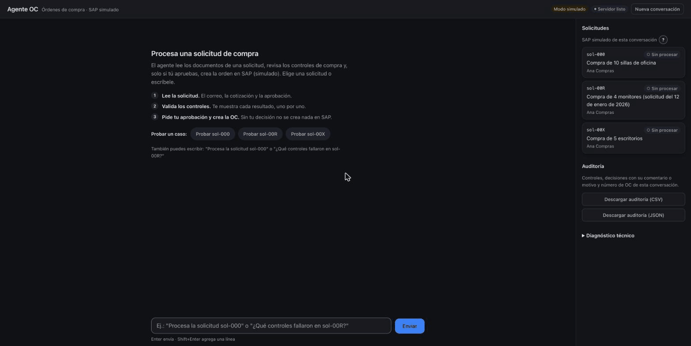

# Reto 3 - Agente conversacional de órdenes de compra (SAP simulado)

**Estado:** flujo completo funcionando con 3 casos de ejemplo; reglas C0–C4 provisionales hasta recibir el PRD. URL pública: pendiente de despliegue (`npm run deploy`, ver [Desplegar](#desplegar)).

El agente lee una solicitud de compra (correo, cotización, aprobación, factura opcional), valida controles de forma determinista, pide **aprobación humana** y crea la orden en un SAP simulado. TypeScript + Hono sobre Cloudflare Workers, un Durable Object por conversación y `@anthropic-ai/sdk` (Sonnet 5.5). Diseño y decisiones: [SOLUCION.md](./SOLUCION.md).



*Casos de ejemplo en modo simulado: sol-000 llega a OC creada tras la aprobación humana; sol-00X se bloquea por el control C1 sin pedir aprobación.*

Requisitos: **Node.js 22.12 o superior** (`.nvmrc` = 22; Wrangler 4 no corre en Node 20) y npm.

## Probar en 1 minuto sin API key

```bash
npm ci
echo MOCK_LLM=1 > .dev.vars     # modo simulado: un guion recorre el flujo, sin llamar a Anthropic (solo en localhost)
npm run dev                     # -> http://localhost:8787
```

Abre <http://localhost:8787> y elige un caso en **Probar un caso** (por ejemplo `sol-000`). Si el puerto 8787 está ocupado: `npm run dev -- --port 8799`.

## Con Claude real

```bash
cp .dev.vars.example .dev.vars  # edita el archivo: comenta MOCK_LLM y descomenta ANTHROPIC_API_KEY=sk-ant-...
npm run dev
```

Sin una clave válida la app arranca y la interfaz avisa en español que falta `ANTHROPIC_API_KEY`. `.dev.vars` está en `.gitignore`: no se versionan secretos.

## Demo, pruebas y evaluación

```bash
npm run demo        # los 3 casos por las tools, SIN LLM, contra fixtures/reto-03/esperados.json (exit 1 si algo no coincide)
npm test            # node:test: aprobación humana, controles, bucle del agente, API, persistencia, UI estática
npm run check       # typecheck + test + demo
ANTHROPIC_API_KEY=sk-ant-... npm run eval   # 7 escenarios con el modelo REAL -> docs/eval-results.md (consume API; no corre en check)
```

`npm run demo -- --matriz` imprime la matriz de controles en Markdown, derivada del código (es la tabla de SOLUCION.md).

## Desplegar

```bash
npx wrangler login                          # una vez
npx wrangler secret put ANTHROPIC_API_KEY   # queda como secreto del Worker
npm run deploy                              # bundle de fixtures + wrangler deploy
```

Tope de gasto diario de la demo pública: variable `DAILY_BUDGET_USD` en `wrangler.jsonc` (5 USD por defecto); al superarlo `/api/chat` responde 503.

## Estructura

| Ruta | Qué es |
|---|---|
| `agent/prompt.md` | System prompt (español) |
| `src/tools/oc.ts` | Tools con schema zod; `registry.ts`: preflight y ejecución |
| `src/domain/` | Dominio puro: `controles/` (registro de controles), `ordenes.ts` (`prepararOrden`), `dinero.ts` (aritmética entera), parser de cotización |
| `src/agent/`, `src/session/` | Bucle del agente con aprobación humana, estado y Durable Object de sesión, auditoría |
| `src/sap/` | Interfaz `SapAdapter` + `InMemorySap` (el SAP simulado) |
| `src/budget/` | Presupuesto diario global (Durable Object contador) |
| `diseno/sap-real/` | Diseño ejecutable del adaptador S/4HANA e idempotencia; **no conectado** (ver su README) |
| `public/` | Chat (HTML/CSS/JS sin build; SSE con fetch) |
| `demo.ts`, `src/demo/` | Demo determinista sin LLM; `scripts/eval.ts`: evaluación con el modelo real |
| `fixtures/reto-03/` | Datos de ejemplo (`sol-000` OK, `sol-00R` con alerta de factura previa, `sol-00X` bloqueada) y `esperados.json` |

## Conectar los datos reales (PRD)

1. Copiar los fixtures a `fixtures/reto-03/` (borrar `sol-000`, `sol-00R`, `sol-00X` y los `_placeholder`).
2. Tipos en `src/domain/types.ts`; controles de la matriz del PRD en `src/domain/controles/definiciones.ts` (+ `index.ts`); mapeo de la OC en `src/domain/ordenes.ts`; formato de `cotizacion.txt` en `src/domain/parsers/cotizacion.ts` (hoy un stub).
3. Resultados esperados de los 6 casos en `fixtures/reto-03/esperados.json` y `CASOS_REQUERIDOS` en `src/demo/run.ts`.
4. Prompt (`agent/prompt.md`) y descripciones de las tools; regenerar la matriz en SOLUCION.md con `npm run demo -- --matriz`.
