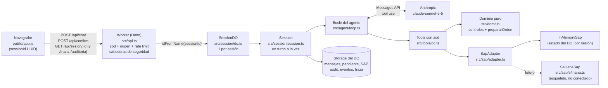
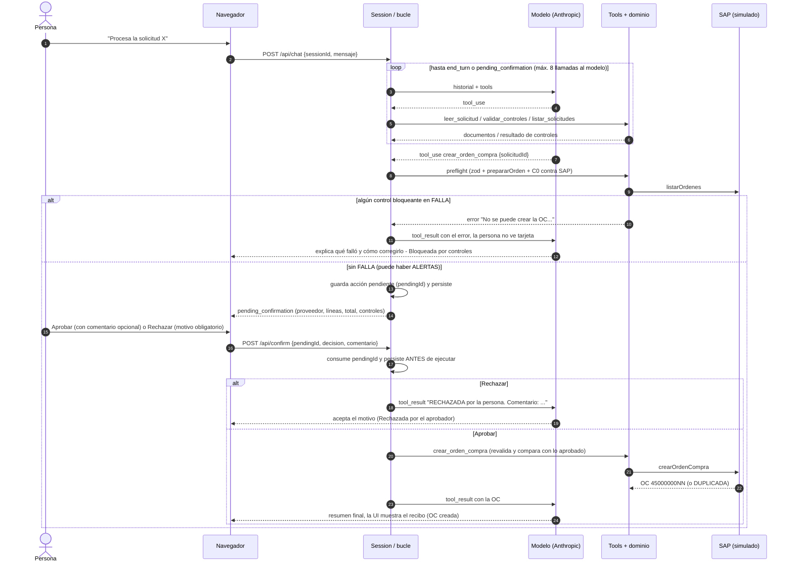

# SOLUCION - Reto 3: Agente de órdenes de compra

Agente conversacional que lee una solicitud de compra (correo, solicitud, cotización, aprobación, factura opcional), valida controles de forma determinista, pide aprobación humana y crea la orden de compra (OC) en un SAP simulado.

> **Estado del documento.** El PRD y los 6 casos reales (sol-001 a sol-006) aún no están integrados. Las reglas de control de este documento son **provisionales** (C0 a C4 en `src/domain/controles/definiciones.ts`) y se ajustan con el PRD. Donde dice `[TODO: PRD]` falta información real; no se inventaron reglas de negocio.

Cómo ejecutar y verificar: ver [README.md](./README.md). `npm run check` corre typecheck, pruebas y la demo determinista (`demo.ts`, sin LLM).

## Arquitectura

El navegador recibe los eventos por SSE (`ui` y un `done` final) y los dibuja: llamadas a herramientas, tarjeta de aprobación, recibo de la OC, traza y costo.

### Por qué cada decisión

- **Un Durable Object por sesión** (`SESSIONS.idFromName(sessionId)`, `wrangler.jsonc`). Da un único escritor por conversación sin coordinar nada: el historial, la acción pendiente, el SAP simulado (OC y contador) y el audit log viven juntos y se guardan en una sola escritura atómica (`SessionStore.save`, un solo `put`). El DO se borra solo tras 24 h sin actividad (alarma, `TTL_MS` en `do.ts`).
- **Historial en el servidor.** El cliente solo envía `{sessionId, mensaje}` o `{sessionId, pendingId, decision, comentario?}`. No puede inyectar `tool_use`, ids duplicados ni historiales enormes. Hay topes por sesión (`CAPS` en `src/agent/state.ts`: mensajes, turnos, eventos) y por turno (`LIMITS` en `loop.ts`: iteraciones, tokens, tiempo por llamada).
- **Un turno a la vez por sesión.** El candado se toma de forma síncrona antes de cualquier `await` y hay un lease persistido (75 s) para que un turno interrumpido no bloquee la sesión. Una segunda petición concurrente recibe 409 `sesion_ocupada`.
- **La OC la arma el servidor, no el modelo.** `crear_orden_compra` solo recibe `solicitudId`. `prepararOrden` (`src/domain/ordenes.ts`) construye proveedor, centro de costo, líneas y total desde los documentos. El modelo no tiene ningún campo de texto libre que llegue a SAP; el único texto libre guardado en la OC es el comentario de la persona que aprueba.
- **Preflight antes de la aprobación humana.** Al llamar `crear_orden_compra`, el bucle ejecuta `preflightTool` (zod + `prepararOrden`, incluido C0 contra el SAP de la sesión). Si hay un control bloqueante en FALLA, el error vuelve al modelo y la persona nunca ve una tarjeta de aprobación. Solo si pasa se guarda la acción pendiente y se emite `pending_confirmation`.
- **`pendingId` consumible.** La decisión solo vale si coincide con el pendiente guardado. `resolvePending` pone `state.pending = null` y **persiste antes de ejecutar**: ni un segundo POST ni un reintento tras un fallo pueden repetirla. Aprobar y rechazar se resuelven una sola vez.
- **Revalidación al ejecutar.** El handler de `crear_orden_compra` vuelve a evaluar los controles y compara el resultado con lo que la persona aprobó (la fecha de emisión se excluye de la comparación y se asigna al crear). Si algo cambió, falla. Además el SAP verifica de forma atómica que la solicitud no tenga ya OC (`DUPLICADA`).
- **Límites de uso.** Worker: binding `CHAT_LIMITER` (20 POST / 60 s por IP) y `READ_LIMITER` (120 GET de sesión / 60 s por IP); si el binding no existe, cae a un limitador en memoria. La IP se toma solo de `CF-Connecting-IP`. Respuesta 429 con `Retry-After: 60`. Además se rechazan orígenes distintos al propio.
- **Cabeceras de seguridad** (`SECURITY_HEADERS` en `src/api.ts`, repetidas en `public/_headers`): `Content-Security-Policy` solo con recursos propios y `frame-ancestors 'self'`, `X-Content-Type-Options: nosniff`, `Referrer-Policy: no-referrer`, `X-Frame-Options: SAMEORIGIN`. El frontend inserta todo texto con `textContent`, nunca `innerHTML`.
- **Contenido no confiable.** Correos y cotizaciones son datos; el prompt (`agent/prompt.md`) ordena ignorar instrucciones dentro de ellos y, sobre todo, ninguna de ellas puede cambiar la OC porque el servidor la arma.

Mapa del repositorio: `agent/prompt.md` (system prompt), `src/tools/oc.ts` (tools zod, adaptadores finos), `src/domain/` (lógica de negocio), `src/sap/` (contrato SAP), `src/agent/` y `src/session/` (bucle y estado), `public/` (chat sin build), `demo.ts` + `src/demo/run.ts` (verificación sin LLM).

## Ciclo del agente

Herramientas (`src/tools/oc.ts`): `listar_solicitudes`, `leer_solicitud`, `validar_controles`, `crear_orden_compra` (la única con `requiresConfirmation: true`), `consultar_orden`, `listar_ordenes`.

Notas del ciclo:

- **Política de controles no evaluables.** Si un control no se puede evaluar (dato ilegible, SAP inaccesible), un control **bloqueante** da **FALLA** con el detalle `No se pudo verificar: ...` (si no puedo verificarlo, no creo la OC); uno de **alerta** da ALERTA y decide la persona. Implementado en `evaluarControl` (`src/domain/controles/index.ts`) y cubierto por pruebas.
- **Resultado final** siempre con uno de cuatro términos: OC creada, Bloqueada por controles, Rechazada por el aprobador, Pendiente de aprobación (prompt y UI usan el mismo vocabulario).
- **Robustez:** nunca queda un `tool_use` sin `tool_result` (reintento único con más `max_tokens`, luego se descarta el turno; saneo del historial); solo se admite una acción con confirmación por turno; la última iteración se hace sin herramientas para forzar un resumen. Si el modelo falla tras crear la OC, la OC queda registrada y el aviso lo dice.
- **Auditoría:** `GET /api/sesion/:id/auditoria` entrega por solicitud los controles, la decisión con su comentario o motivo y marcas de tiempo, el número de OC, las herramientas llamadas y el costo por turno y total. La identidad de quien aprueba **no** se registra: la demo no tiene autenticación (ver "Qué haría con más tiempo").

## Matriz de controles

> **Reglas provisionales; se ajustan con el PRD.** Son los controles de ejemplo con los que se construyó la plataforma. Generada desde el registro con `npm run demo -- --matriz` (columna "Estado" agregada a mano).

| ID | Control | Regla | Severidad | Fuente | Acción si no se cumple | Estado |
|---|---|---|---|---|---|---|
| C0 | OC existente | La solicitud no tiene ya una OC en SAP (idempotencia: una solicitud genera a lo sumo una OC). | bloqueante | SAP (OC de la sesión) | Revisa si la solicitud ya tiene su orden; no hace falta procesarla de nuevo. | Implementado (provisional) |
| C1 | Proveedor en maestro | El proveedor existe en el maestro, está activo y no está bloqueado. | bloqueante | maestros/proveedores.json + solicitud.json | Cambia el proveedor de la solicitud por uno activo y vuelve a procesarla. | Implementado (provisional) |
| C2 | Cotización vs solicitud | El total de la cotización coincide con el total de la solicitud (comparación en centavos enteros). | bloqueante | cotizacion.txt + solicitud.json | Corrige la cotización o la solicitud para que los totales coincidan y vuelve a procesarla. | Implementado (provisional); el parser de la cotización es un stub |
| C3 | Aprobación | Existe una aprobación vigente y su monto aprobado cubre el total. | bloqueante | aprobacion.json + solicitud.json | Consigue una aprobación vigente que cubra el monto y vuelve a procesarla. | Implementado (provisional) |
| C4 | Orden retroactiva | No debe existir factura previa a la OC; si existe, es una posible orden retroactiva y decide un humano. | alerta | factura.txt (opcional) | Confirma con compras que la factura previa es válida antes de continuar. | Implementado (provisional) |

Semántica: incumplir un control **bloqueante** da FALLA (no se crea OC y la persona no ve tarjeta de aprobación); incumplir uno de **alerta** da ALERTA (se muestra destacado y decide la persona). C0 es contextual (depende del estado de SAP, no de los documentos), por eso no figura en `esperados.json`.

Pendiente con el PRD: reglas reales, umbrales y topes de aprobación por líder y centro de costo, uso de los maestros `centros-costo`, `indicadores-iva` y `condiciones-pago` (el cargador ya los lee si existen, sin esquema asumido), y el resultado esperado de sol-001 a sol-006 en `fixtures/reto-03/esperados.json`.

## Diseño del adaptador SAP real

La interfaz `SapAdapter` (`src/sap/adapter.ts`) tiene tres operaciones: `crearOrdenCompra`, `consultarOrden`, `listarOrdenes`, y el error tipado `SapError` (`DUPLICADA`, `NO_ENCONTRADA`, `INVALIDA`). Un adaptador real implementa la misma interfaz y el resto del sistema no cambia. `src/sap/s4hana.ts` es un **esqueleto** (compila, no está conectado, nunca se ejecuta en pruebas ni en la demo) que sigue este diseño.

**Qué es hoy el SAP simulado.** `InMemorySap` opera sobre el estado de cada sesión (Durable Object): numeración 4500000001 en adelante por sesión y OC propias. La idempotencia de C0 vale dentro de la sesión. En producción hay un solo SAP compartido y la idempotencia debe venir de una clave por solicitud, como se describe abajo.

**Opción A (preferida en S/4HANA): OData `API_PURCHASEORDER_PROCESS_SRV`.**

- Crear: `POST A_PurchaseOrder` con deep insert de posiciones (`to_PurchaseOrderItem`) e imputación a centro de costo (`to_AccountAssignment`). Consultar: `GET A_PurchaseOrder('<número>')`. Listar: `GET` con `$filter`, `$top` y paginación.
- Mapeo desde `CrearOrdenInput`: `proveedorId` a proveedor (`Supplier`), `moneda` a moneda del documento, `items` a posiciones (10, 20, 30...; descripción, cantidad, precio neto), `centroCosto` a la imputación. Sociedad, organización de compras, grupo de compras, centro y clase de documento son **configuración fija** de Compras, no entradas del modelo ni del usuario.
- Escrituras: SAP exige un **token CSRF** (GET previo con `x-csrf-token: Fetch`, reenviar el token y las cookies de sesión).

**Opción B: `BAPI_PO_CREATE1` por RFC** (ECC o S/4 on-premise). Se expone detrás de un servicio intermedio (SAP Integration Suite/CPI o un microservicio Node con conector RFC), porque un Worker no puede abrir RFC. La BAPI trae un flag `TESTRUN` nativo y devuelve mensajes en `BAPIRET2`; hay que ejecutar `BAPI_TRANSACTION_COMMIT` explícitamente solo si no hubo mensajes de error.

**Autenticación y red.**

- Servicio a servicio con **OAuth2** (credenciales de cliente) contra el SAP o contra SAP BTP; el secreto vive en Workers Secrets, nunca en el repo ni en el modelo.
- Para saber **quién** aprobó, propagar la identidad del aprobador (**principal propagation**: JWT del IdP corporativo, p. ej. Cloudflare Access, intercambiado en BTP por un usuario SAP). Hoy la demo no autentica a nadie.
- SAP on-premise se alcanza por **BTP Destination + Cloud Connector** (túnel saliente); no se expone SAP a internet.

**Idempotencia** (la misma garantía que C0 / `DUPLICADA`).

1. La solicitud viaja como **referencia externa** de la OC (campo de referencia del documento; en el esqueleto `CorrespncExternalReference`, por validar).
2. Antes de crear: `GET ... $filter=<referencia> eq '<solicitudId>'`. Si existe, `DUPLICADA` con el número de la OC existente (el preflight lo usa para bloquear antes de molestar a la persona).
3. Si un `POST` falla por red o por un 5xx, **no se reintenta a ciegas**: puede haber tenido éxito. Se vuelve a consultar por referencia; solo si no existe se reintenta.
4. Como defensa adicional, serializar por solicitud (p. ej. un Durable Object con clave `solicitudId` o un bloqueo en SAP) para evitar dos creaciones simultáneas desde sesiones o instancias distintas. Hoy el candado es por sesión, no global.

**Reintentos.** Backoff exponencial con jitter y tope, **solo** ante errores seguros: 429, 502, 503, 504 y fallos de red. Nunca ante errores de negocio (400/409/422) ni de autorización (401/403). Un 401 se atiende renovando el token una vez.

**Mapeo de errores.** SAP devuelve el detalle en `error.innererror.errordetails[]` (OData) o en `BAPIRET2` (BAPI; `TYPE` = E/A es error, W advertencia, I/S información). Reglas del esqueleto: 404 a `NO_ENCONTRADA`; 409 o mensaje de documento existente a `DUPLICADA`; 400/422 a `INVALIDA` (con el mensaje SAP para que el agente lo explique); el resto (401, 403, 5xx, red) es error técnico que el bucle registra con un id de correlación y al usuario le llega un mensaje genérico.

**Simulación antes de confirmar (TESTRUN).** Con BAPI, `TESTRUN = 'X'` valida sin grabar. OData V2 no trae ese flag; el esqueleto ofrece `testRun` que arma y valida el payload y consulta idempotencia sin hacer `POST`. Uso previsto: ejecutar la simulación en el **preflight**, de modo que la persona vea en la tarjeta de aprobación los avisos de SAP (precio, impuestos, presupuesto) antes de decidir.

**Auditoría y observabilidad.** Cada llamada a SAP se registra (operación, estado HTTP, latencia, referencia de la solicitud; nunca tokens ni cuerpos con datos sensibles) y se cruza con el audit log de la sesión (`pendingId`, aprobador, comentario, número de OC). El esqueleto expone un callback `audit` para eso.

**Pruebas del adaptador real.** El mismo conjunto de pruebas de contrato que corre contra `InMemorySap` (creación, duplicado, consulta inexistente, OC vacía) debe correr contra un sandbox SAP antes de usarlo.

## Análisis crítico de órdenes retroactivas

> **Estado:** marco de análisis general. Los casos concretos se completan con los `factura.txt` del PRD (ver el marcador al final de esta sección).

**Qué es.** Una **orden retroactiva** (*after-the-fact PO*) es una OC que se registra **después** de que el proveedor ya entregó o facturó: la factura tiene fecha anterior a la OC. El proceso esperado es solicitud, aprobación, **OC**, recepción, factura. Aquí el compromiso con el proveedor se adquirió antes de que existiera el compromiso formal en SAP.

**Por qué es un desvío de control y no solo un trámite.**

- **Se rompe la secuencia de autorización.** El gasto se comprometió sin que el aprobador viera la OC; la aprobación pasa a ser una ratificación de algo ya hecho y pierde su función preventiva.
- **Gasto "maverick" / no gestionado.** Compras fuera del proceso evitan condiciones negociadas, comparación de cotizaciones y contratos marco.
- **Conciliación a tres vías (OC, entrada de mercancía, factura) debilitada.** Sin OC previa no hay referencia contra la cual validar cantidades y precios, y la entrada de mercancía puede ser posterior o inexistente. Se abre la puerta a pagar sin verificar la recepción.
- **Riesgo de fraude y de colusión.** Es el patrón típico de un empleado que pide al proveedor "facturar primero y regularizar después", y de fraccionamiento de compras para quedar bajo los topes de aprobación.
- **Control presupuestal y contable.** El compromiso no estaba reservado en el presupuesto, se pueden devengar gastos en un periodo cerrado y el IVA y las retenciones pueden registrarse en un periodo equivocado.
- **Auditoría.** Las órdenes retroactivas son un indicador de riesgo estándar; un porcentaje alto es hallazgo en sí mismo.

**Cuándo permitir (con escalamiento) y cuándo bloquear.** Propuesta de política, que debe validarse con Compras, Finanzas y Auditoría:

| Situación | Tratamiento propuesto |
|---|---|
| Emergencia documentada (parada de planta, seguridad, servicio crítico), monto bajo, proveedor activo y aprobación del líder | Permitir con **escalamiento**: justificación escrita, aprobación adicional (compras o finanzas) y registro en el log de excepciones |
| Error de proceso aislado, mismos importes de cotización y aprobación, sin diferencias con la factura | Permitir con alerta y aprobación humana explícita |
| Importe de la factura distinto de la cotización o de lo aprobado | **Bloquear** hasta resolver la diferencia |
| Proveedor inactivo, bloqueado o sin alta | **Bloquear** (el alta de proveedor tampoco puede ser retroactiva) |
| Sin aprobación previa vigente, o monto sobre el tope del aprobador | **Bloquear** y escalar al nivel correspondiente |
| Recurrencia del mismo solicitante o proveedor, o patrón de montos justo bajo el tope | **Bloquear** y reportar a Auditoría |

**Qué hace hoy el agente (C4, provisional).** C4 es de severidad **alerta**: si existe un `factura.txt` previo a la OC, marca el caso como posible orden retroactiva, lo muestra destacado en la tarjeta de aprobación y deja la decisión a una persona (puede aprobar con comentario o rechazar con motivo; ambos quedan en la auditoría). No bloquea por sí mismo: la política de bloqueo de la tabla se aplica a través de los **otros** controles (C1, C2, C3), que sí son bloqueantes. Un agente no debe "perdonar" una retroactiva por su cuenta; solo la hace visible y trazable.

**Mejoras que haría con el PRD** (hoy solo se detecta la presencia de factura):

- Comparar la **fecha de la factura contra la fecha de creación de la OC** y la de la aprobación, en vez de solo "existe factura".
- Comparar importe de factura vs. cotización vs. aprobación.
- Exigir **justificación estructurada** y un aprobador adicional para las retroactivas, y reportar su frecuencia por solicitante y proveedor.
- Convertir C4 en bloqueante si el PRD lo define así (con la excepción documentada de emergencia).

**Casos concretos: se completa con sol-00X del PRD.** [TODO: PRD] Para cada caso con `factura.txt`: qué detecta C4, qué dicen las fechas e importes, qué debería decidir el aprobador y qué desvío del proceso esperado se observa.

## Decisiones y trade-offs

- **Controles deterministas fuera del modelo.** El modelo orquesta y explica; las reglas viven en funciones puras (`src/domain`), con datos y no con prosa en el prompt. Costo: cada regla nueva es código.
- **Preflight antes de aprobar, revalidación al ejecutar.** Doble verificación para no molestar a la persona con casos imposibles ni crear una OC con datos que cambiaron. Costo: se evalúa dos veces.
- **SAP simulado por sesión.** Cada visitante de la demo tiene su propio SAP y no se bloquea con duplicados de otros. Costo: C0 solo garantiza idempotencia dentro de la sesión; en producción hace falta clave por solicitud (ver adaptador SAP).
- **Un turno a la vez y estado persistido tras cada paso.** Simple y robusto frente a doble clic y reinicios. Costo: sin concurrencia dentro de una sesión.
- **Sin aprobación identificada.** El `sessionId` actúa como secreto (bearer): quien lo tenga puede aprobar, incluso el solicitante. Aceptable para una demo; en producción exige autenticación y separación de funciones.
- **Costo estimado por turno** (`src/agent/cost.ts`): tarifa de `claude-sonnet-5-5` de USD 2 por millón de tokens de entrada y USD 10 de salida (lectura de caché 0,10; escritura 2,50) y caché de prompt en system, tools y último mensaje. Es una estimación con la tabla de precios guardada en el código, no una factura; hay que actualizarla si cambia el modelo o la tarifa.
- **Demo sin LLM** (`demo.ts`): llama a las mismas tools y al mismo preflight que el agente, con fecha de referencia fija, y compara con `esperados.json` en ambas direcciones (todo esperado tiene fixture y todo fixture tiene esperado). Falla con código 1 ante cualquier diferencia. Constante `CASOS_REQUERIDOS` lista para exigir sol-001 a sol-006.
- **Modo `MOCK_LLM`** (solo desarrollo: exige `MOCK_LLM=1` y además host local o `ENV=dev`; `mockEnabled` en `src/llm/mock.ts`): un cliente simulado permite probar la UI y el flujo sin clave.

## Qué haría con más tiempo

- Integrar el PRD y los 6 casos: reglas reales, topes por líder y centro de costo, uso de `indicadores-iva` y `condiciones-pago` en el armado de la OC, y un parser real de `cotizacion.txt` (hoy es un stub).
- Autenticación (Cloudflare Access/OIDC), identidad del aprobador en la auditoría y separación de funciones (aprobador distinto del solicitante).
- Adaptador SAP real contra un sandbox, con las pruebas de contrato compartidas con `InMemorySap`.
- Auditoría con almacenamiento duradero fuera del DO (hoy la sesión se borra a las 24 h) y exportación firmada.
- Evaluación del agente con un conjunto de conversaciones (incluyendo intentos de inyección de prompt en correos y cotizaciones) y métricas de costo y latencia por caso.
- Pruebas end-to-end del frontend en navegador (hoy el frontend se verifica a mano; las pruebas automáticas cubren servidor, bucle y dominio).
