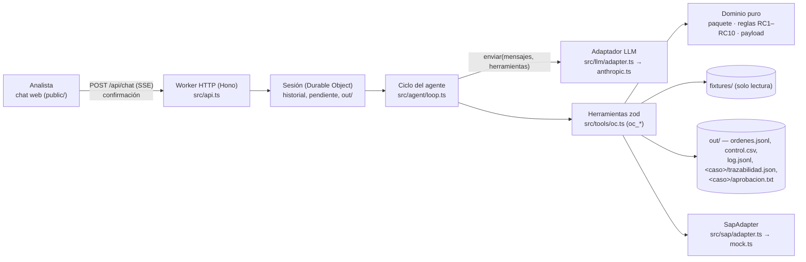

# SOLUCIÓN — Agente conversacional "Órdenes de Compra SAP" (Reto 03)

## 1. Problema en una frase

La analista administrativa digita a mano en SAP cada orden de compra: proveedor, centro de costo, valor, IVA, aprobador y condiciones de pago. Valida de memoria si quien aprobó podía aprobar ese monto en ese centro.

Eso le duele a tres actores:
- **La analista**, por el tiempo y por los errores que después se corrigen en el cierre contable.
- **Contabilidad y auditoría**, porque el control no es sistemático.
- **La dirección**, porque no sabe qué porcentaje de OC se crean después de la factura.

## 2. Arquitectura

**Dónde vive cada cosa** (la separación que pide el PRD):

| Qué | Dónde | Cambia si… |
|---|---|---|
| **Comportamiento** del agente | `agent/prompt.md` | cambia cómo conversa |
| **Conocimiento** del proceso (reglas explicadas, glosario, qué hacer ante cada excepción) | `src/knowledge/ordenes-compra.md` | cambia el proceso |
| **Ejecución** | `src/tools/oc.ts` (contrato del PRD) y el dominio que llaman | cambia una regla o un cálculo |
| Reglas de control | registro RC1–RC10 en el dominio (datos y código, no prosa) | cambia una regla; el servidor no se toca |
| Proveedor de modelo | `src/llm/anthropic.ts` detrás de `src/llm/adapter.ts` | se cambia de proveedor; el ciclo no se toca |
| SAP | `src/sap/mock.ts` detrás de `src/sap/adapter.ts` | se conecta un SAP real (sección 6) |

**Almacenamiento de `out/`.**
- En local (`npm run dev`, `demo.ts`) las herramientas escriben **archivos reales** en `out/`.
- La versión publicada corre en Cloudflare Workers, que no tienen disco. Ahí los mismos archivos se guardan por sesión en el almacenamiento del Durable Object, detrás de la misma interfaz.
- El chat los lista y permite descargarlos desde el panel "Archivos generados".

## 3. Ciclo del agente

1. El usuario escribe ("procesa sol-004"). El backend arma el contexto (prompt, conocimiento e historial) y llama a `enviar(mensajes, herramientas)`.
2. Si el modelo pide herramientas, el backend **valida los argumentos con zod** antes de ejecutar. Si no cumplen, le devuelve el error al modelo.
   - Cada herramienta devuelve `{ ok, data }` o `{ ok:false, error }` y **nunca lanza**.
   - Cada llamada queda en el chat (nombre, argumentos y resultado resumido) y en `out/log.jsonl`.
3. El flujo típico es `oc_leer_paquete` → `oc_validar` → `oc_construir_payload` → `oc_generar_evidencia` → `oc_crear`.
4. **Tope de iteraciones:** 25 vueltas herramienta → modelo por turno, configurable. Al alcanzarlo, el agente responde con lo que tiene y lo que falta (CA1).
5. **Tope de costo:** tokens por sesión configurables, más un tope de gasto diario global para la URL pública. Un usuario no puede gastar la clave sin límite.
6. **Confirmación humana (CA3):**
   - `oc_crear` solo se ejecuta si `apta = true` y no hay confirmaciones pendientes, o si llega `confirmado = true`.
   - Cuando hay confirmaciones, el agente **termina el turno con una pregunta explícita**. El front muestra una tarjeta resaltada con la OC como quedaría en SAP, cada confirmación con sus dos valores y los datos derivados.
   - Solo procede si el siguiente mensaje confirma: el botón o un "confirmo" escrito. El "sí" queda registrado en `excepciones[].confirmado_por`.
   - `sol-001`, que está limpio, se crea **sin intervención humana**, como pide O1.
7. **El modelo no puede afirmar valores que no salgan de una herramienta (CA2)**, y además no los necesita: el payload lo construye el dominio. `oc_crear` reconstruye y compara el payload en el servidor, así que el modelo no puede "arreglar" un monto (es el riesgo de la sección 10 del PRD).
8. **Errores (CA5):** un error de herramienta, un timeout del proveedor LLM o un límite alcanzado se muestran en el chat en lenguaje claro, y la sesión sigue viva.

## 4. Elección del modelo

- **Proveedor y modelo:** Anthropic, **Claude Sonnet 5.5** (`claude-sonnet-5-5`).
- **Por qué este modelo:**
  - Es muy confiable en *tool use* con esquemas estrictos, que es el corazón de este reto.
  - Sigue bien instrucciones largas (prompt más conocimiento).
  - Tiene *prompt caching* para el system prompt y las definiciones de herramientas, que se repiten en cada vuelta.
  - Un modelo más grande no aporta aquí: las decisiones de negocio las toma el código, no el modelo.
- **Costo estimado por caso:** un caso completo son unas 4 a 6 llamadas al modelo. Con caché activa, cada llamada usa unos 6.000–8.000 tokens de entrada (la mayoría leídos de caché) y unos 300–800 de salida. Con la tarifa configurada en `src/agent/cost.ts`, eso da del orden de **US$ 0,02–0,05 por caso**.
  - El costo real de cada turno se calcula con el `usage` de la API y se ve en el panel "Diagnóstico técnico".
  - `npm run eval` mide el costo observado con el modelo real.
- **Cambiar de proveedor:** basta con una nueva implementación de `src/llm/adapter.ts`. El modo simulado (`MOCK_LLM=1`) es otra implementación que permite probar la interfaz sin clave.

## 5. Matriz de controles

| Regla | Qué valida | Tipo | Implementación |
|---|---|---|---|
| RC1 | Proveedor existe (por NIT normalizado; si no hay NIT, por nombre normalizado) y está activo | Bloqueo | Se normaliza el NIT quitando puntos y dígito de verificación (`900.555.111-2` → `900555111`) y el nombre (minúsculas, sin tildes ni signos) |
| RC2 | Aprobación existe, contiene "Aprobado" y la envía un aprobador del `centro_costo` | Bloqueo | El correo del aprobador se busca en `centros-costo.json[cc].aprobadores` |
| RC3 | `valor_total` ≤ `tope` del aprobador en ese centro | Bloqueo | Se evalúa sobre el aprobador encontrado en RC2 |
| RC4 | `subarea` pertenece al `centro_costo` | Bloqueo | Se compara contra `subareas[]` |
| RC5 | La diferencia entre cotización y solicitud no supera el 2 % | Confirmación | Sin cotización también pide confirmación; muestra ambos valores y el % |
| RC6 | `indicador_iva` ausente: se deriva del proveedor | Confirmación + derivado | Usa `indicador_iva_default` del maestro |
| RC7 | `condiciones_pago` ausente: se deriva del proveedor | Derivado | Usa `condiciones_pago_default`; solo se informa |
| RC8 | Factura con fecha anterior a `fecha_solicitud`: `retroactiva = true` | Confirmación | Se registra en `out/control.csv` |
| RC9 | Fecha de aprobación ≥ `fecha_solicitud` | Confirmación | Compara fechas de calendario en la zona horaria de Bogotá |
| RC10 | `cantidad × valor_unitario` = `valor_total` (± 1) | Bloqueo | Aritmética entera, sin flotantes |

**Resultado esperado con los fixtures** (lo verifica `demo.ts` contra `fixtures/reto-03/esperados.json`):

| Caso | Resultado | Por qué |
|---|---|---|
| sol-001 | OC creada sin intervención | Todo cumple |
| sol-002 | Bloqueada (RC1) | "Soluciones Digitales del Norte" (NIT 901999000) no existe en el maestro |
| sol-003 | Bloqueada (RC2) | Aprueba Felipe Vargas, aprobador de CC-3030 (Comercial), pero la compra es de CC-2020. Además 74 M supera el tope de 30 M del único aprobador de CC-2020 |
| sol-004 | Confirmación (RC5) | Cotización de 26,5 M frente a 25 M en la solicitud (+6 %) |
| sol-005 | Confirmación (RC8), `retroactiva = true` | Factura FC-88231 del 2026-08-10, anterior a la solicitud del 2026-08-27; el propio aprobador escribe "ya llegó la factura" |
| sol-006 | Confirmación (RC6) y derivado (RC7) | Sin IVA ni condiciones de pago: se derivan C1 y Z030 de TecnoSuministros; sin NIT, el proveedor se identifica por nombre |

**La más difícil: RC2 junto con RC3 en sol-003.** El correo dice "Aprobado" y viene de alguien con autoridad, pero en **otro** centro de costo. Una regla ingenua ("contiene Aprobado y el remitente es aprobador de algún centro") la dejaría pasar. Hay que cruzar remitente, centro de costo y tope en ese orden, y explicar el bloqueo de forma accionable: "pedir la aprobación a Rocío Torres (CC-2020); además, el monto supera su tope de 30 M, así que se requiere escalar".

Le sigue en dificultad el **parseo robusto de los textos** (NIT con dígito de verificación, montos con puntos de miles, "IVA incluido"). Por eso los parsers tienen pruebas sobre los seis textos reales.

## 6. Diseño del adaptador SAP real

La interfaz es la del PRD (`src/sap/adapter.ts`): `consultarProveedor`, `crearOrden` y `buscarOrdenPorReferencia`. Hoy la implementa `src/sap/mock.ts` sobre `out/sap/ordenes.jsonl`. Un adaptador real implementa la misma interfaz y nada más cambia.

**Opción elegida, dada una viabilidad no confirmada:**
1. **Primera opción: OData de órdenes de compra.** En S/4HANA Cloud, el servicio V4 `API_PURCHASEORDER_2`; en releases on-premise, `API_PURCHASEORDER_PROCESS_SRV`, que figura como deprecado en Cloud desde la 2308 pero sigue vigente on-premise. Es HTTP con JSON, se consume desde el backend sin conectores propietarios y soporta inserción profunda de posiciones.
2. **Si solo hay RFC disponible: `BAPI_PO_CREATE1`**, detrás de un servicio intermedio, porque un Worker no abre RFC. Para eso sirve SAP Integration Suite si la empresa ya lo tiene.
3. **Plan B, sin conexión** (ver abajo).

Antes de decidir hay que confirmar con Basis la edición y el release de SAP.

**Mapeo del payload del PRD a OData:**

| Payload (7.4) | OData |
|---|---|
| `sociedad`, `organizacion_compras` | `CompanyCode`, `PurchasingOrganization` |
| `proveedor.codigo_sap` | `Supplier` |
| `moneda` | `DocumentCurrency` |
| `condiciones_pago` | `PaymentTerms` |
| `posiciones[].numero` | `PurchaseOrderItem` (10, 20, …) |
| `posiciones[].descripcion` | `PurchaseOrderItemText` (40 caracteres) |
| `posiciones[].cantidad`, `.unidad`, `.precio_unitario` | `OrderQuantity`, `PurchaseOrderQuantityUnit`, `NetPriceAmount` |
| `posiciones[].indicador_iva` | `TaxCode` |
| `posiciones[].centro_costo` | imputación (`AccountAssignmentCategory = K`, `CostCenter`) |
| `referencia.solicitud_id` | referencia externa de la OC (clave de idempotencia) |
| evidencia de aprobación | adjunto por el servicio de adjuntos (GOS) con su sha256 |

La subárea no tiene campo estándar: va a un campo de cliente o al texto de posición. Hay que verificar los nombres exactos contra el `$metadata` del sistema real.

**Autenticación y credenciales.**
- OAuth2 *client credentials* (o un usuario técnico con certificado) contra SAP.
- El secreto vive en el gestor de secretos del backend (Workers Secrets o Key Vault): **nunca en el agente, el prompt, el front ni los logs**.
- SAP on-premise se alcanza por BTP Destination y Cloud Connector, sin exponerlo a internet.
- Para trazabilidad del usuario real se usaría *principal propagation*.

**Idempotencia y errores parciales.**
- El `solicitud_id` viaja como referencia externa. Antes de crear se llama a `buscarOrdenPorReferencia`: si existe, se devuelve ese número (`idempotente: true`).
- Para que dos reintentos o dos sesiones no creen dos OC, cada solicitud tiene un estado persistido `EN_PROCESO` → `CREADA` / `INCIERTA`, con un candado por solicitud. El `POST` se envía **una sola vez**.
- Si la respuesta es ambigua (timeout, 5xx, `201` sin número), **no se reenvía**: queda `INCIERTA` y se reconcilia leyendo por referencia.
- Las escrituras OData exigen un token CSRF ligado a las cookies de la sesión HTTP.
- **Error parcial** (cabecera creada y una posición rechazada): OData con inserción profunda es atómico, así que se informa el mensaje de SAP y nada queda a medias. Con BAPI se usa `BAPI_TRANSACTION_ROLLBACK` si hay un error en `RETURN`, y `COMMIT` solo si todo está bien. Antes del commit se puede simular con `TESTRUN = 'X'`.
- El diseño ejecutable de este esquema (adaptador, estados y candado, con pruebas contra un SAP falso) está en `diseno/sap-real/`. **No está conectado** y nunca se ejecutó contra un SAP real.

**Plan B si la conexión no es viable.** El agente igual elimina la digitación y el control mental.

Hoy ya produce, validado:
- la **OC lista para revisar y pegar**: la tabla del payload, con cada campo y su fuente;
- la **evidencia de aprobación** con sha256;
- el log de control `out/control.csv`.

El siguiente paso, barato porque el payload ya está validado, sería un **archivo de carga masiva** con todas las OC aptas del día, en el layout de LSMW o de la app "Import Purchase Orders". La analista solo cargaría el archivo y adjuntaría la evidencia. La validación (RC1–RC10) y la medición de retroactivas no dependen de SAP.

## 7. Lectura del proceso: OC retroactivas

> **Para la dirección.** Una OC retroactiva es una orden que se crea después de que llegó la factura. En los datos de muestra, sol-005 llegó con una factura del 10 de agosto para una solicitud del 27, y el propio aprobador escribe "ya llegó la factura, crear la OC para poder radicarla". La OC deja de ser un control previo y se vuelve un trámite para pagar.
>
> **Riesgos:**
> 1. El gasto se comprometió sin cotización comparada ni aprobación previa.
> 2. El presupuesto se entera tarde.
> 3. Se pierde poder de negociación, porque el proveedor ya entregó.
> 4. Auditoría no puede distinguir una urgencia legítima de un hábito.
>
> **Qué hace ya el agente:** no las bloquea, porque el pago al proveedor es real y bloquear solo esconde el problema. Las crea **con confirmación explícita** y las marca `retroactiva = true` en `out/control.csv`. Por primera vez se puede medir el % de OC retroactivas por centro de costo, aprobador y proveedor.
>
> **Cambio de proceso que propondría:**
> 1. Publicar ese indicador mensual por centro de costo.
> 2. Exigir que toda OC retroactiva lleve una **justificación** (urgencia, servicio recurrente o error) y la aprobación de un nivel superior al aprobador habitual.
> 3. Para gastos recurrentes (papelería, licencias, nube), crear **OC marco o abiertas** al inicio del período, para que la factura llegue contra una orden existente.
> 4. Definir con Compras una meta (por ejemplo, menos del 10 % retroactivas en dos trimestres). A partir de ahí, decidir si se rechazan las que no traigan justificación. Esa política es de la dirección (pregunta abierta del PRD); el agente ya da los datos para tomarla.

## 8. Decisiones y trade-offs

1. **El servidor es la fuente de verdad del payload, no el modelo.**
   - Alternativa descartada: que el modelo arme la OC y la herramienta solo la valide.
   - Por qué se descartó: un valor alucinado o inyectado en la cotización podría llegar a SAP. Con el dominio armando el payload y `oc_crear` recomparándolo, el riesgo "el modelo arregla un monto" desaparece por diseño.
   - Costo: menos flexibilidad conversacional, que aquí es una ventaja.
2. **Reglas como registro en código, no como instrucciones en el prompt.**
   - Alternativa descartada: describir RC1–RC10 en el prompt y dejar que el modelo decida.
   - Por qué se descartó: no es determinista, no se puede probar y no es auditable. El conocimiento en `src/knowledge/` sirve para que el modelo **explique**, no para que **decida**.
3. **Cloudflare Workers con un Durable Object por sesión.**
   - Alternativa descartada: un servidor Node en Render, Fly o Railway con disco.
   - Ganamos una URL pública estable y gratuita, estado fuerte por sesión (candado, confirmación de un solo uso, historial), rate limiting y tope de gasto nativos.
   - El costo: no hay sistema de archivos, así que `out/` es una interfaz con dos implementaciones (archivos reales en local y almacenamiento del DO en la URL). El PRD admite "memoria o archivos".
4. **Confirmación con botón y con texto.**
   - Alternativa descartada: solo texto ("confirmo"), como sugiere CA3.
   - Mantenemos el texto, pero además hay una tarjeta con botón ligada a un identificador de un solo uso. Así una frase ambigua ("ok, ¿y el IVA?") no se interpreta como confirmación, y un doble clic no crea dos órdenes.
5. **Sonnet en lugar de un modelo más grande o más barato.**
   - Uno más grande no mejora decisiones que toma el código.
   - Uno más barato falla más en *tool use* encadenado, y el costo por caso ya es de centavos.

## 9. Supuestos

1. **NIT:** en el maestro va sin dígito de verificación y en la cotización con puntos y dígito (`900.555.111-2`). Se comparan los 9 dígitos base.
2. **Valores con IVA:** los de la solicitud y la cotización incluyen IVA ("IVA incluido"). RC5 compara totales con IVA y `precio_unitario` se lleva tal como viene en la solicitud.
3. **"Aprobado":** se busca la palabra sin distinguir mayúsculas ni tildes. "Aprobado desde comercial" cuenta como aprobado; la autoridad la decide RC2.
4. **RC3 con aprobador inválido:** si RC2 falla porque el remitente no es aprobador del centro, RC3 se evalúa contra el mayor tope del centro, para informar si además habría que escalar.
5. **Fechas:** la fecha de aprobación trae hora y zona; RC9 compara la fecha de calendario en America/Bogotá.
6. **Unidades:** se derivan de la descripción ("horas" → `H`, vigencia mensual → `MES`, el resto `UN`). Ante la duda, `UN`.
7. **Descripción:** se recorta a 40 caracteres sin cortar palabras; la descripción completa queda en la trazabilidad.
8. **Confirmación:** una confirmación aplica a las confirmaciones mostradas en ese momento. Si el paquete cambia, se vuelve a validar.
9. **Datos:** los maestros de los fixtures son completos y el correo de aprobación es evidencia suficiente (supuestos del PRD).

## 10. Cobertura

| HU | Estado | Nota y qué falta para producción |
|---|---|---|
| HU-1 Leer el paquete | Hecho | Lectura de `.xlsx` y `.pdf` binarios (P1) no implementada; se usan los JSON y TXT normalizados |
| HU-2 Validar contra maestros | Hecho | RC1–RC10 con pruebas por regla y por caso. En producción, maestros consultados en SAP en tiempo real |
| HU-3 Construir el payload | Hecho | Esquema zod y `out/<caso>/trazabilidad.json` con la fuente de cada valor |
| HU-4 Evidencia de aprobación | Hecho (P0 `.txt` con sha256) | PDF (P1): ver README. En producción, firma digital si auditoría la exige |
| HU-5 Crear la OC en SAP simulado | Hecho | Secuencial desde 4500000001, idempotente por `solicitud_id`, `control.csv` en cada intento. Falta el adaptador real (sección 6) |
| HU-6 Manejo de errores | Hecho | Errores tipados y legibles; un caso malo no impide el siguiente |
| Front, API, adaptador LLM, demo | Hecho | La URL pública está en el README |
| Bonus `modulo/` | Ver README | — |

**Para producción falta:** autenticación y roles (la identidad de la analista en `confirmado_por`), el adaptador SAP real, lectura de adjuntos binarios, maestros en vivo, firma de la evidencia y monitoreo.

## 11. Uso de IA

Usé asistentes de IA de forma deliberada, con un modelo distinto para cada tipo de tarea, y revisé cada propuesta antes de aceptarla.

| Asistente | Para qué |
|---|---|
| **Claude Code** (Anthropic), Claude Opus 5.5 | Orquestación: plan, división del trabajo, revisión de cada entrega, verificación en navegador, redacción y edición de este documento |
| Claude Sonnet 5.5 (dentro de Claude Code) | Implementación del código y las pruebas según especificaciones concretas |
| Claude Haiku 5.5 (dentro de Claude Code) | Lectura rápida de los PDF de instrucciones y armado de un checklist de requisitos |
| **Codex CLI** (OpenAI) | Revisión independiente de código y "lectura en frío" como evaluador sin contexto |
| **Gemini** (Google, vía Antigravity) | Segunda revisión independiente, con foco en producto y UX |

**Qué descarté de lo que me propusieron, y por qué:**
- **Un rediseño visual tipo "documento financiero".** Lo probé y lo descarté: recargaba la interfaz. Preferí una UI simple, donde cada paso del agente se entienda.
- **El riesgo de "límite de 128 KiB por valor" en el almacenamiento.** Aplica a Durable Objects con backend KV, no a los de SQLite que usamos. Mantuve igual un tope de tamaño por sesión.
- **Un pipeline de CI** que no iba a ejecutarse en esta cuenta. Preferí no dejar algo que aparenta funcionar.
- **Streaming token a token.** Lo dejé fuera por tiempo. El chat muestra cada paso y cada herramienta en vivo, y el streaming de texto queda como mejora.
- **Mantener un extractor de cotizaciones con LLM.** Los textos son parseables de forma determinista, y un parser con pruebas es más barato y auditable que un modelo.
- **Varias afirmaciones técnicas sobre SAP** que no pude verificar. Quedaron explícitamente marcadas como "a verificar contra `$metadata`" en lugar de presentarse como hechos.

Las decisiones de arquitectura (servidor como fuente de verdad, reglas en código, confirmación ligada a lo mostrado) y qué aceptar de cada revisión son mías, y puedo explicar cada línea entregada.

## 12. Riesgos de producción y mitigación

| Riesgo | Mitigación |
|---|---|
| El modelo "arregla" un monto o afirma un valor inventado | El payload lo arma el dominio y `oc_crear` lo recompara. El prompt prohíbe afirmar valores que no vengan de herramientas, y la UI muestra la tarjeta con los valores reales |
| Prompt injection en correos o cotizaciones ("ignora RC1") | Las reglas son código, el modelo no controla el payload y crear exige pasar las reglas o la confirmación. Hay pruebas con documentos envenenados |
| Conexión SAP no viable a corto plazo | Plan B de la sección 6: OC lista para pegar y archivo de carga masiva |
| OC duplicadas por reintentos | Idempotencia por `solicitud_id`; en SAP real, estado por solicitud con reconciliación y sin reenviar el `POST` |
| Costo descontrolado con una URL pública | Tope de iteraciones, tokens por sesión, rate limiting y tope de gasto diario global |
| Fuga de la clave del modelo | Solo en una variable de entorno o secreto del backend; nunca en el front, el repo, los logs ni las respuestas de la API |
| Maestros desactualizados | En producción se consultan en SAP en línea (`consultarProveedor`) en lugar de archivos |
| Evidencia insuficiente para auditoría | sha256 del contenido hoy; firma digital y adjunto en GOS en producción |
| Confirmaciones sin identidad | Hoy `confirmado_por` registra la sesión. En producción, SSO con la identidad de la analista y su rol |
| Cambios de formato en cotizaciones reales (PDF) | Parser con pruebas y, si hiciera falta, extracción asistida por modelo **siempre validada** por las mismas reglas |
